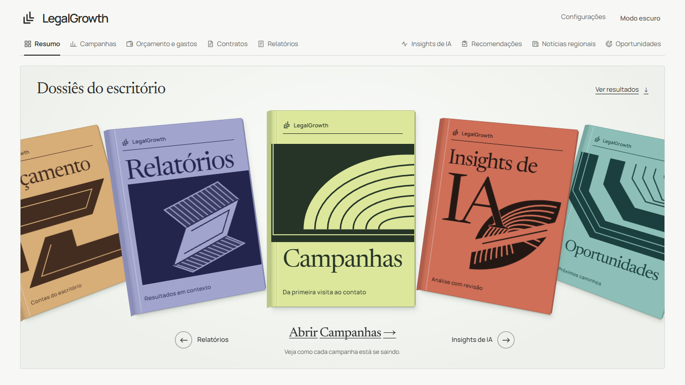
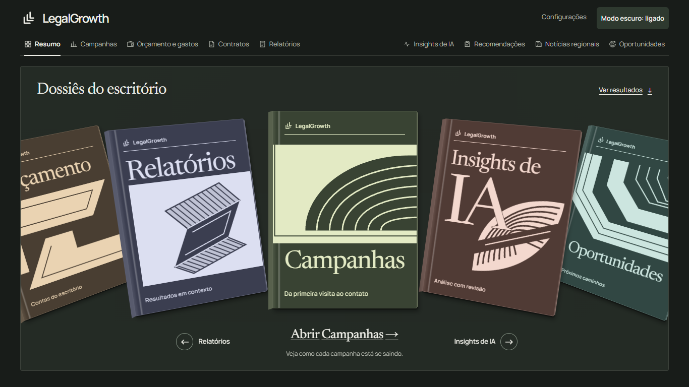

# LegalGrowth AI

MVP local de inteligência de marketing jurídico, com FastAPI, SQLAlchemy 2, Alembic, Pandas, Jinja2 e APScheduler. Sem serviços pagos obrigatórios e sem publicação automática. Interface em português, temas claro/escuro e API autenticada. O estado detalhado da nova especificação está em [docs/EVOLUTION-2026-10-22.md](docs/EVOLUTION-2026-10-22.md).

Projeto sob [licença MIT](LICENSE), em desenvolvimento em repositório privado;
a publicação pública será uma decisão separada. [Documentação](docs/README.md) ·
[Como contribuir](CONTRIBUTING.md) · [Segurança](SECURITY.md) ·
[Licenças de terceiros](THIRD_PARTY_NOTICES.md).



<details><summary>Ver o modo escuro</summary>



</details>

O Resumo abre com uma coleção navegável de dossiês. **Ver resultados** leva
diretamente aos indicadores e filtros. Campanhas, orçamento, relatórios e análises
continuam acessíveis pelo menu principal.

Marco atual: **v0.1.3**, versão visual v56. Capas e cabeçalhos compartilham gravuras
autorais, com cores coerentes nos dois temas. A interface sinaliza tabelas
roláveis, cobertura parcial e recuperação após falhas de atualização. Veja as
[decisões e validações](docs/DESIGN-ENGINEERING.md), o
[estudo interativo da Arc](docs/ARC-INTERACTION-STUDY.md), a
[avaliação da Cartier](docs/CARTIER-REFERENCE.md) e o
[parecer independente](docs/THE-CRITIC-DESIGN-ENGINEERING.md).
O ciclo de perseguir uma nota foi encerrado por decisão do proprietário;
esta versão é apresentada com evidências e limitações, sem alegação de perfeição.

## Início rápido no Windows / PowerShell

Redesign e manutenção visual: [sistema de design atual](DESIGN.md),
[implementação atual](docs/DESIGN-ENGINEERING.md) e [skills e origens](docs/DESIGN-SKILLS.md).
Capturas completas ficam em `output/design-review/` na máquina de desenvolvimento;
essa pasta é ignorada pelo Git. As prévias acima acompanham o repositório.

Requisito: Python 3.12+. Na pasta do projeto:

```powershell
py -3.12 -m venv .venv
.\.venv\Scripts\python.exe -m pip install -r requirements-dev.txt
.\.venv\Scripts\python.exe -m app.cli init
.\.venv\Scripts\python.exe -m app.cli seed
.\.venv\Scripts\python.exe -m uvicorn app.api:app --host 127.0.0.1 --port 8000 --workers 1
```

Mantenha esse terminal aberto enquanto usa o painel. Após reiniciar o computador,
execute novamente apenas o comando `uvicorn` acima, na pasta do projeto. Não é
necessário recriar o ambiente, apagar o banco ou gerar outra senha.

Abra http://127.0.0.1:8000. Usuário `admin`, senha no campo `ADMIN_PASSWORD` do arquivo local `.env`. O comando `init` gera senhas aleatórias se o arquivo ainda não existir. Não imprime nem versiona as senhas. Usuário `viewer`, com `VIEWER_PASSWORD`, pode consultar, mas não importar, aprovar ou modificar configurações. Se copiar `.env.example` manualmente, preencha as senhas antes de iniciar.

O navegador usa autenticação HTTP Basic. Apenas loopback em desenvolvimento; ao hospedar, HTTPS e limitação de tentativas no proxy são obrigatórios. Fechar todas as janelas do navegador encerra o cache usual de credenciais Basic; não há gestão de contas ou logout de sessão no MVP.

Selecione **Exemplo fictício** no topo para visualizar 90 dias fictícios. O padrão é **Meus dados**, inicialmente vazio. A marcação `scope` é obrigatória em cada linha e validada contra o ambiente escolhido. Nomes, fontes e indicadores demonstrativos são inventados e rotulados. Nunca remova o rótulo para apresentar esses resultados como reais.

## Personalizar sua instalação

Uma instalação corresponde a um escritório. Não é necessário usar Cruzeiro:
essa cidade permanece apenas nos exemplos fictícios e em configurações antigas
que você já tenha salvo.

| O que personalizar | Onde | Efeito |
|---|---|---|
| Cidades atendidas | **Configurações → Sua região de atuação** | Novas importações e coletas usam a seleção salva no ambiente atual. |
| Claro ou escuro | Botão de tema no painel | Preferência salva neste navegador; as duas paletas são mantidas. |
| Provedor e limite de IA | **Configurações → Conectar IA** | OpenAI ou Claude; chaves guardadas cifradas, sem editar código. |
| Orçamento | **Gastos → Ajustar orçamento** | Limites e distribuição mensal do próprio escritório. |
| Período de análise | Filtros do painel | Consulta dados existentes, sem reescrever o histórico. |
| Horário dos relatórios | `.env`: `REPORT_DAY`, `REPORT_HOUR`, `REPORT_MINUTE`, `TIMEZONE` | Requer reiniciar o servidor; veja Agendamento. |
| Fontes jornalísticas | Catálogo `SOURCES` em `app/integrations/news.py` | Personalização pelo mantenedor, com revisão e testes; veja abaixo. |
| Identidade visual | `DESIGN.md`, fundações em `app/static/tokens.css`; componentes em `style.css` e `arc.css` | Altere os pares claro/escuro e confira contraste e celular. |

### Escolher sua região, passo a passo

1. No topo, escolha **Meus dados**. **Exemplo fictício** tem configuração separada.
2. Em **Configurações**, preencha uma cidade e selecione sua UF.
3. Use **Adicionar cidade** para incluir outros municípios; **Remover** tira uma
   linha da seleção. A alteração só é persistida ao clicar em **Salvar região**.
4. No CSV, use exatamente a grafia salva seguida de hífen e UF: `Curitiba-PR`.
   A validação aceita as 27 unidades federativas e limita a lista a 20 cidades, mas não consulta
   o IBGE nem comprova que um município existe. Confira a grafia.
5. Em **Notícias regionais**, confira a região mostrada antes da coleta.

Mudar a seleção não apaga campanhas, não muda cidades de registros antigos e
não refaz relatórios existentes. Uma coleta antiga continua associada à seleção
original. Uma nova região começa sem notícias salvas daquela combinação.

### Fontes de notícias e cobertura

Os jornais incluídos inicialmente cobrem o Vale do Paraíba, em SP. Escolher outra
cidade não acrescenta um jornal automaticamente. O sistema não substitui a região
escolhida por Cruzeiro quando não encontra notícias.

Para adaptar a instalação a outro local, um mantenedor deve revisar o catálogo
`SOURCES` em `app/integrations/news.py`: identificador, nome, domínio HTTPS,
caminho do RSS, limite de páginas e estados cobertos. Use apenas fontes públicas
conhecidas, com permissão de leitura, e teste com RSS fictício antes de coletar.
Não coloque URLs de usuários diretamente nesse catálogo, nem habilite redirects
ou leitura de endereços internos. Esses limites reduzem o risco de SSRF, quando
uma URL induz o servidor a acessar serviços privados da rede.

O gateway também mantém uma lista dos identificadores permitidos das fontes;
atualize-a junto do catálogo. O roteiro técnico completo está em
[Cidades e cobertura](docs/localidades.md), com a função central explicada linha
por linha e um exercício sobre isolamento do histórico.

A coleta lê títulos e trechos, não todo o site. Município e estado devem ser
compatíveis com a fonte; mesmo assim, a identificação por texto pode ser ambígua.
Ausência de notícia não prova ausência de acontecimentos. O agendamento de
notícias no Codex é separado do agendamento de relatórios em `.env`; quem clonar
o projeto precisa configurar sua própria execução de `python -m app.cli news`.

### Atualizar e aprender com as versões

O repositório de desenvolvimento é [thomaszstrvm/legalgrowth-ai](https://github.com/thomaszstrvm/legalgrowth-ai),
**privado**. Cada entrega verificada recebe um commit; marcos recebem tags.
O número da versão identifica uma entrega, não uma nota de design.
Consulte [CHANGELOG.md](CHANGELOG.md) e [guia de versionamento](docs/VERSIONING.md).

Para estudar as decisões de interface, veja também a
[avaliação das skills de front-end](docs/LLM-SKILLS-REVIEW.md), incluindo o
tratamento acessível de erros e a proteção dos valores digitados.

Antes de atualizar, preserve `.env`, `.secrets/` e o banco em um backup local
protegido. Com o servidor parado, atualize o código e execute:

```powershell
.\.venv\Scripts\python.exe -m pip install -r requirements-dev.txt
.\.venv\Scripts\python.exe -m alembic upgrade head
.\.venv\Scripts\python.exe -m pytest -q
```

Migrações evoluem a estrutura do banco sem recriá-lo. O cadastro de cidades usa
uma configuração existente; a chave geográfica separa históricos de notícias.
**Exercício:** em Exemplo fictício, cadastre uma segunda cidade, volte a Meus
dados e explique por que a seleção não deveria mudar. Não use dados de clientes.

## Conectar uma IA pelo painel

1. Abra **Configurações → Conectar IA**.
2. Escolha OpenAI ou Claude, cole sua chave e clique em **Testar e conectar**. Há um link na própria tela para criar a chave.
3. Volte ao **Resumo** ou às **Recomendações** e clique em **Analisar com IA**.

O botão de conexão testa a chave antes de salvá-la. Não precisa editar `.env` nem reiniciar para conectar. A chave fica criptografada no banco e nunca é devolvida ao navegador. Para remover a conexão, clique em **Desconectar**.

A IA seleciona até cinco prioridades entre recomendações fundamentadas nos dados; não cria métricas, fontes, anúncios ou decisões financeiras. O painel permanece utilizável sem IA. Apenas totais numéricos, categorias predefinidas e IDs internos são enviados. Nomes de campanhas, palavras-chave e textos de clientes não são enviados.

As consultas podem ser cobradas pelas contas OpenAI e Anthropic. O painel reserva R$ 1 por tentativa, com limite mensal inicial de R$ 60 para novas conexões, ajustável em **Limite de uso**. Essa reserva conservadora bloqueia chamadas adicionais, mas não é a fatura nem uma cotação em tempo real. Confira o consumo no provedor e registre a despesa efetiva em **Gastos**, sem somar a reserva como despesa paga. Detalhes e limites: `docs/AI.md`.

## Fluxo de utilização

1. **Configurações → Sua região de atuação:** escolha de uma a vinte cidades, informando nome e UF, e clique em **Salvar região**. Instalações novas não presumem uma cidade para os dados reais. Configurações já salvas são preservadas. O plano mensal fica em **Gastos → Ajustar orçamento**.
2. **Campanhas:** importe CSV UTF-8 no formato de `examples/campaigns_demo.csv`. Os filtros de período e área afetam as métricas e gráficos de campanhas. O financeiro sempre considera todas as áreas no mês da data final.
3. **Recomendações → Ver ideias de conteúdo:** importe indicadores agregados com origem, data, unidade e URL oficial. O CSV de exemplo contém somente indicadores sintéticos.
4. **Recomendações:** clique em **Revisar resultados** (sem IA) ou **Analisar com IA** (quando conectada), abra **Ver dados** e aprove/descarte recomendações. O motor analisa todas as áreas; o filtro de área só aparece em Campanhas. Aprovar registra a decisão, sem executar mudanças externas.
5. **Gastos:** registre despesas de ferramentas e anúncios não incluídos em importações. Não registre manualmente anúncios já importados. Compare com o mês anterior e acompanhe alertas de 80%, 90% e 100%.
6. **Relatórios:** escolha uma segunda-feira e gere o relatório; exporte PDF ou JSON. Uma semana corresponde a segunda a domingo, inclusivos. Relatórios são snapshots imutáveis por ambiente e semana. Importar dados atrasados não atualiza automaticamente um relatório já gerado.

Também é possível gerar a última semana completa pela linha de comando:

```powershell
.\.venv\Scripts\python.exe -m app.cli report --scope demo
```

Os arquivos ficam em `output/pdf/`. Para gerar com dados reais, use `--scope real`.

## CSV de campanhas

Separador: vírgula; codificação UTF-8 (BOM aceito); decimal com ponto; datas ISO `AAAA-MM-DD`. Arquivo até 2 MB e 10.000 linhas. Todos os campos são obrigatórios; colunas extras são rejeitadas. Não importar linhas de totais nem diferentes níveis de agregação juntos.

| Coluna | Contrato |
|---|---|
| scope | `demo` ou `real` |
| date | Dia do registro |
| campaign_id | ID agregado estável; letras, números, hífen ou sublinhado |
| campaign | Nome agregado, até 120 caracteres |
| area | `trabalhista` ou `previdenciario` |
| locality | Cidade habilitada em Configurações, no formato `Nome-UF`, por exemplo `Curitiba-PR` |
| keyword | Palavra-chave agregada; não incluir termos de pesquisa com dados pessoais |
| impressions, clicks | Inteiros não negativos; cliques <= impressões |
| cost | Reais, não micros; até duas casas decimais |
| conversions | Contagem inteira de conversões configuradas no anúncio |
| contacts, qualified, appointments, hires | Contagens agregadas do funil; decrescentes nessa ordem |

**Grão:** campanha × dia × localidade × palavra-chave. Contatos e contratações precisam estar atribuídos exatamente a esse grão, sem repetir totais em cada palavra-chave. Defina um modelo de atribuição antes de juntar Google Ads e controles internos. Este esquema assume um funil da mesma coorte; outros modelos exigem adaptação. Conversões fracionárias do Google Ads não são aceitas nesta versão; não arredonde silenciosamente.

O CSV é um formato normalizado, não uma aceitação universal de exportações brutas do Google. Renomeie e transforme as colunas conforme o contrato. Nome e área da campanha são estáveis por ID. Uma reimportação idêntica é ignorada; valores diferentes para a mesma chave são rejeitados em transação integral. Não há atualização silenciosa. A origem `real` é declaração do responsável, não certificação automática de veracidade.

**Métricas:** CTR = cliques/impressões × 100; CPC = gasto/cliques; CPQ = gasto/qualificados; custo por contratação = gasto/contratações. São razões de totais, não médias de razões. Denominador zero produz `N/D`, nunca infinito. Conversão não é contrato. Zero importado é zero informado; ausência de dias é cobertura incompleta. O relatório informa dias presentes, mas não conhece campanhas que deixaram de ser exportadas.

## CSV de mercado

Campos: `scope,date,source,source_url,accessed,topic,area,locality,value,unit`. Mesmos formatos básicos. Dados reais exigem URL HTTPS em domínio oficial `gov.br`; a URL é armazenada como proveniência e não é acessada pelo servidor. A fonte deve permitir o uso e os valores devem ser verificados pelo responsável. Não presumimos API universal ou estabilidade de scraping.

Evolução compara as duas observações mais recentes da mesma fonte, tema, localidade e unidade, até o fim do período. Contexto demográfico não é volume de buscas, propensão individual nem prova de demanda comercial. Nenhum dado público foi fabricado para preencher o ambiente real. O exemplo sintético usa `example.invalid`.

## Arquitetura

```text
app/api.py                 rotas, autenticação e páginas
app/models.py              entidades e restrições SQL
app/repositories.py        consultas com isolamento explícito de scope
app/schemas.py             validação Pydantic
app/services/              importação, métricas, financeiro e relatórios
app/agents/                regras de análise e triagem de conformidade
app/integrations/          contratos de Google Ads e provedor generativo
app/scheduler.py           agendamento no fuso de Brasília
app/templates/, static/    Jinja2, CSS e JavaScript sem framework
migrations/                migração Alembic versionada
tests/                     regras, importação, API, aprovação e relatórios
```

O ambiente local usa SQLite; o Compose usa PostgreSQL. Valores monetários persistem como Numeric/Decimal. Não há multitenancy de escritórios: `scope` separa real/demo, não organizações. Uma instalação atende um escritório; futuro SaaS precisa tenant_id, permissões e isolamento de ponta a ponta.

## Agendamento

No `.env`, configure `SCHEDULER_ENABLED=true`, `REPORT_DAY=mon`, `REPORT_HOUR=9`, `REPORT_MINUTE=0`, `TIMEZONE=America/Sao_Paulo` e reinicie. Use **um worker**. APScheduler roda no processo, exige aplicação ligada e não repõe execuções perdidas enquanto a aplicação esteve desligada; gere manualmente nesse caso. Jobs simultâneos são limitados e há unicidade SQL de semana/ambiente. Erros são registrados sem prompts ou chaves. Não há envio por e-mail nesta versão.

## Docker e PostgreSQL

Defina `POSTGRES_PASSWORD` no `.env` com uma senha aleatória URL-safe e mantenha as credenciais administrativas geradas. Configure também `AI_ENCRYPTION_KEY` com uma chave Fernet. Gere-a com `python -c "from cryptography.fernet import Fernet; print(Fernet.generate_key().decode())"`, copie para o `.env` e proteja esse arquivo. Ela deve permanecer estável para abrir as chaves de API salvas. Execute:

```powershell
docker compose up --build -d
```

O banco não expõe porta; a aplicação fica em `127.0.0.1:8000`. Migrações são aplicadas na inicialização. O volume `pgdata` persiste o banco. Para dados demo use `docker compose exec app python -m app.cli seed`. Faça backups antes de alterações de schema. Para hospedagem externa, configure TLS, firewall, rate limit, backup/restauração e gestão de segredos; o Compose local não resolve esses itens.

## Integrações e limitações deliberadas

- Google Ads: importador funcional e contrato `GoogleAdsReader` somente leitura. Adaptador OAuth/API real ainda não implementado; exige conta autorizada, developer token e definição do relatório. Não existem métodos de alteração de verba ou publicação.
- IA: OpenAI e Claude conectados pelo painel; prioridades, insights e cenários públicos. Gateway obrigatório antes da geração. Detalhes de privacidade, reservas e limitações em [docs/AI.md](docs/AI.md). Testes usam respostas simuladas; não foram executados benchmarks pagos.
- Conformidade: triagem lexical preliminar, sem parecer jurídico. Não armazena o texto avaliado. Pode falhar para paráfrases e gerar falsos positivos. Toda publicação exige revisão de advogado; a aprovação de recomendação não aprova automaticamente qualquer anúncio.
- Privacidade: somente esquema agregado; regex de rótulos bloqueia alguns padrões evidentes, mas não é DLP completo. Não inserir dados pessoais em campos de texto. Sem scraping de processos, pessoas, idosos vulneráveis ou listas de prospecção.
- Orçamento: mídia padrão de R$ 2.000, distribuída inicialmente em R$ 1.400 trabalhista e R$ 600 previdenciário. Ferramentas e IA têm consumo separado. Planos já salvos são preservados e a interface avisa sobre alocações antigas. Alertas não bloqueiam gastos no Google Ads.
- Análises: limiares de 20% para aumento de CPC/CPQ, R$ 50 sem qualificado e 100 cliques/10 qualificados são heurísticas operacionais, não significância estatística. Não geramos estimativas de ROI.

## Testes e verificação

```powershell
.\.venv\Scripts\python.exe -m pytest -q
.\.venv\Scripts\python.exe -m alembic check
```

Consulte `docs/VALIDATION.md` para o que foi efetivamente executado neste ambiente, incluindo limitações de PostgreSQL/Docker. `requirements-lock.txt` registra as versões usadas na validação. Não execute seed em dados reais; o comando só grava `demo`.

## Normas e fontes

Revisão documental em 21/10/2026: ver `docs/COMPLIANCE.md`. Fontes oficiais foram consultadas, mas propostas de atualização não foram consolidadas como regras vigentes. Revalidação jurídica antes do uso externo é necessária.

## Novas áreas

- **Notícias da região → Análise estratégica:** impacto social e potencial financeiro independentes. Sem base suficiente, nenhuma nota é inventada.
- **Configurações → Contratos e clientes:** demonstração fictícia do extrator; upload real bloqueado até verificar os controles de segurança.
- **Relatórios → Testar a conferência de erros:** seis mutações conhecidas em cópias fictícias, sem alterar relatórios ou usar APIs pagas.
- **Relatórios → Arquivo para outra IA:** exportação estruturada com dados selecionados e nomes de grupos substituídos por códigos.

Decisões arquiteturais em `docs/decisions/`; estudo guiado em [docs/MENTORIA-2026-10-22.md](docs/MENTORIA-2026-10-22.md). O projeto permanece um MVP local, não um sistema liberado para documentos confidenciais.
