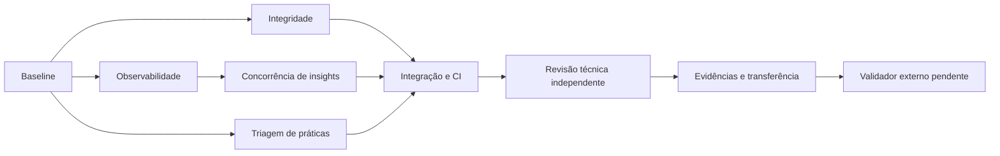

# Consolidação - 25/10/2026

Base: `main`, `036ba1f26d08011729e15727eda2641d2c9ce4d4`. Incremento local, sem
commit, push, deploy ou alteração de visibilidade. Não há nova versão publicada.

## Incremento após revisão externa — contrato local do cache

Defini o escopo como **portfólio**, com dados fictícios e engenharia
cuidadosa; não é autorização de produção. Esta seção atualiza os estados de revisão
e concorrência abaixo, mantendo os resultados originais como históricos.

O Validador reproduziu limite de explicação reduzido somente em memória de 500
para 40: schema externo, assinatura e fingerprint permaneciam iguais, e uma
explicação salva de 75 caracteres era reutilizada embora rejeitada pelo novo modelo.
A correção mínima inclui os schemas completos de `Analysis` e `Review` na assinatura,
além dos schemas reduzidos existentes. Estes continuam sendo os únicos enviados ao
provedor. Não se reescreveram cache, claims ou notícias. A referência de autenticação
no mapa foi corrigida para `app/security.py`.

Fonte independente: `receipt.json` do diretório temporário
`validador-20261025-isolated`, SHA-256
`9c3b92f5d288e3937c44a8c68ff943412ddd3fd4ef9491395577ab40efac81d3`.
O recibo foi conferido; caminhos de máquina, logs e chaves sintéticas não precisam
ser publicados. Resultado **daquela rodada**, sem nova execução aqui:

- 213 testes aprovados, uma falha de preparação (`.env.example` ausente no cwd
  isolado), 22 TestClient excluídos após bloqueio em `socketpair`/timeout de 45 s.
  Isso não equivale a 236 aprovações independentes.
- SQLite entre processos: iguais, períodos diferentes e falha com tentativa
  explícita aprovados. Sintaxe JS: 5/5. Três contratos JS não iniciaram por
  `chdir EPERM`; não são falhas funcionais nem testes aprovados.
- 35 hashes e arquivos de testes intactos naquela entrega. PostgreSQL real,
  banco existente e CI remota não foram validados.

Verificações **novas deste incremento**, com Python local `-B -I`, cwd temporário
sem `.env`, `DATABASE_URL=sqlite:///:memory:`, scheduler desligado e provedores
simulados; `pytest -p no:cacheprovider`, `--basetemp` e JUnit fora do repositório:

| Escopo | Resultado |
|---|---|
| Nova regressão, antes da correção | 1 falha: assinatura não mudava com o limite local |
| Mesma regressão, após correção | 1 aprovado; schema externo igual, assinatura/fingerprint novos, registro incompatível não reutilizado |
| `test_insights.py`, `test_insight_concurrency.py`, `test_ai_observability.py`, `test_data_integrity.py`, `test_news.py` | 86 aprovados, 2 TestClient explicitamente excluídos por fixture, 1 aviso de depreciação Starlette/httpx |

Critério de conclusão: contrato local influencia a identidade do cache, nenhuma
restrição adicional sai para o provedor e o resultado inválido da simulação fica
com status `failed`, sem conclusões exibidas. A assinatura completa cobre os
schemas JSON consumidos; mudanças em validadores Python fora desses schemas ainda
exigem versionamento explícito.

Revisão final do Validador, 25/10 às **07:15 UTC**: conferência estática da assinatura
com os schemas completos de Analysis/Review, payload externo preservado, regressão
500→40 com controle de cache anterior e JUnit de 86 casos sem erros. Hash do JUnit:
`cb2be684d5eb6c13c5609d23518228cdf23cd958bbf128bbdc3679c14e9ce261`.
O recibo independente acima também foi conferido. Não foi nova execução independente.
Sem bloqueador concreto, o recorte cache/docs foi liberado para preparação de commit.
As duas exclusões, aviso e sequência red/green estão documentados pelo implementador,
mas não foram conferidos independentemente por logs: comandos/logs adjacentes não
existem no diretório temporário. Não foram reconstruídos como evidência original.

Não foram repetidos CI, migrações, navegador, contratos JS ou PostgreSQL nesta
correção de assinatura sem mudança de banco/frontend. PostgreSQL real permanece
pendência, não requisito para ampliar esta rodada de portfólio. Não houve acesso
ao banco atual, instalação, API paga, nova permissão, commit ou push. Design e filme
1.1.1 foram preservados. O ZIP/PDF/manifesto anteriores continuam históricos;
a fonte atual é o diff e estes documentos, preparados para revisão e futura
publicação autorizada no GitHub privado.

## Diagnóstico inicial

**Implementado:** gateway de privacidade, cotas atômicas, cache versionado sequencial,
notícias com coleta/unicidade próprias, revisão humana, testes, Remotion separado,
THE CRITIC permanente e oito skills locais de design verificadas.

**Parcial:** observação do custo apenas por cota, coordenação concorrente de insights,
índice documental longo. OCR possui interface técnica, sem engine/produção validada.

**Pendente confirmado:** agrupamento por nome fundia IDs distintos, schema Decimal
aceitava valores incompatíveis, faltava workflow CI. **Hipótese inicial:** travamento
de testes poderia ser regressão; diagnóstico mostrou `socketpair()` do sandbox,
antes da aplicação. Execução autorizada fora da restrição passou.

Pré-existiam quatro arquivos modificados em `media/legalgrowth-presentation` e
`docs/FILM-CORRECTION-V7.md` não rastreado. Preservados integralmente nesta rodada;
seu status não significa conclusão audiovisual. Relatórios externos recentes foram
localizados no diretório do Validador (23/10); não são validação deste novo diff.

## Grafo e responsabilidades

| ID / tarefa | Responsável / entradas / dependências | Arquivos / saída / aceitação | Estado e evidência |
|---|---|---|---|
| B baseline | Principal; HEAD, diff, AGENTS, índice | Estado preservado; nenhuma sobrescrita | DONE: inspeção Git e mapa CURRENT-STATE |
| D integridade | data_integrity; B, modelos e consumidores | metrics/imports/schemas/analysis/app.js + testes; IDs isolados, Decimal exato e importação atômica | DONE: regressões 8 falhas antes; 57 testes dados/core depois e JS |
| O observabilidade | ai_observability; B, adapters/AI.md | AICall/migração/contexto + adaptadores; NULL e sem conteúdo | DONE: 23 testes novos; suíte dirigida do agente 70 aprovados |
| C concorrência | Principal; B e interface observe_call de O | insights/InsightClaim/migração + testes; uma reserva por entrada ativa | DONE: 2 falhas antes; 6 testes de concorrência/cache corrigidos |
| P práticas/plugins | plugin_review; B, PDF e fontes oficiais | Triagem 30 itens, inventário 8/8 e demonstração copy sintética | DONE: nenhum pacote instalado; todos os itens com página |
| I integração/CI | Principal; D/O/C/P | Workflow local, instruções curtas, docs/ADR; suíte sem regressões conhecidas | DONE local: 236 testes + JS + SQLite; CI remota não executada |
| R revisão independente | independent_review; I, somente leitura | Parecer segurança/QA; reprodução de achados | DONE: P2 de cache corrigido; 54 testes independentes aprovados |
| E evidências | Principal; R | PDF inspecionado, manifesto e pacote sem segredos | DONE: pacote de transferência local e relatório desta rodada |
| V validação externa | Projeto Validador; E | Inspeção independente do diff/contratos | NEEDS_REVIEW: não enviada nem simulada aprovação |

## Mudanças e contratos

- Campanhas: chave do dicionário `campaigns` passa a ser a PK convertida em string;
  `label` mantém o nome exibido. Comparações e fingerprints de recomendações usam ID.
  Frontend escapa o nome, aceita estruturas históricas e preserva layout. Consumidores
  externos que usavam o nome como chave precisam adotar ID + label.
- Indicadores: precisão 16, escala 4, finitos e limite máximo explícitos. SQLite
  não representa todos os decimais desse domínio com exatidão; a importação recusa
  os que mudariam no round-trip em vez de arredondar. Nenhuma migração para esta correção.
- IA: metadados por chamada e exclusão concorrente, detalhados em [AI.md](AI.md) e
  [ADR 013](decisions/013-insight-coordination-and-observability.md). Reservas conservadas;
  falhas não viram crédito de volta. Sem precificação, proxy ou novo modelo.
- Duas migrações aditivas: `a031c472bb10` (ai_calls) e `b142d583cc21` (insight_claims).
  Somente bancos descartáveis foram migrados. Banco existente requer backup e upgrade
  antes de executar a versão nova; não fizemos essa operação no banco local do usuário.
- Processo: AGENTS referencia CONTRIBUTING, estado atual e fluxo mínimo; sem duplicar
  instruções globais. Configuração do `visual_critic`, DESIGN.md e estilos preservados.
- HTTP real bloqueado nos transportes httpx do pytest. MockTransport/TestClient
  continuam funcionando. Não é um firewall global para outras bibliotecas.

## Testes efetivamente executados

| Comando / escopo | Resultado |
|---|---|
| `python -m pytest -q --junitxml=output/consolidation-2026-10-25/pytest.xml` | **236 aprovados**, 6 avisos de depreciação, 4,84 s na execução final do código |
| Regressões dados antes/depois | 8 falhas + 15 aprovados antes; depois 25 novos + 32 core aprovados |
| Regressões concorrência antes/depois | 2 falhas + 1 aprovado antes; depois 6 aprovados, incluindo identidade, órfão e orçamento |
| Revisão independente: dados/concorrência/observabilidade | 54 aprovados; sem alterações do revisor |
| `node scripts/test-period-context.cjs` | Datas, limites, aplicação do período e mês aprovados |
| `node scripts/test-demo-examples.cjs` | 3 factories, 12 proteções de escopo; sem rede/storage |
| `node scripts/test-campaign-labels.cjs` | Duas campanhas homônimas, escape HTML e fallback aprovados |
| `node --check` em todos os JS de app/static | Aprovado |
| `python scripts/verify-migrations.py --sqlite-only` | Upgrade/check/downgrade/upgrade/check aprovados em banco descartável |
| `python scripts/verify-migrations.py` | **Falha preservada** na compilação PostgreSQL offline histórica 9b27d3e1a102; SQLite passou antes |

As rodadas iniciais travadas no sandbox foram interrompidas e não contadas como
sucesso. O traceback localizou `socketpair()`/event loop do TestClient, não uma
asserção do produto. A suíte final usou autorização de execução local fora dessa
restrição. Não se alteraram testes para esconder o problema.

Avisos: Starlette/httpx legado, Alembic sem path_separator (quatro ocorrências) e
API add_js do pypdf em teste sintético. Não instalamos substitutos por causa dos avisos.
CI é arquivo preparado, não execução remota; nenhuma franquia de Actions foi usada.

## Parecer interno, limites e backlog

O revisor independente reproduziu reutilização incorreta após trocar a identidade
da campanha mantendo nome e números. O cache agora exige fingerprint persistido;
a regressão passou. Parecer interno favorável após correção, **sem aprovação externa**.
Não houve mudança visual relevante: não foram produzidas capturas de UI ou nova
nota do THE CRITIC. O teste de renderizador JS não substitui inspeção visual futura.

Prioridades:

1. **P2:** validar PostgreSQL em instância descartável, inclusive migração histórica
   de dados; o modo offline completo continua não suportado. Manter o check visível.
2. **P2:** aplicar migrações em manutenção após backup quando integrar este diff;
   confirmar operação do ambiente alvo. Não confundir testes com atualização do banco real.
3. **P2:** Validador externo revisar pacote; CI remota depende de autorização de publicação.
4. **P3:** teste de concorrência entre processos, retenção/consulta operacional de metadados,
   atualização planejada dos avisos de dependência. Sem promessa de auditoria completa.
5. **Separado:** validação audiovisual 1.1.1, OCR, novas funcionalidades, modelos locais,
   marketing ampliado e plugins. Não abertos como frentes de implementação aqui.

Ganhos observados: dois defeitos de dados e duplicação concorrente reproduzidos/corrigidos;
revisor identificou um caso adicional real. Custos adicionais: duas tabelas, contexto
de observação e documentação operacional. Não medimos economia de tokens, latência,
custo financeiro ou produtividade; não inferir esses resultados do paralelismo.

Fontes técnicas: [SQLite/SQLAlchemy](https://docs.sqlalchemy.org/en/20/dialects/sqlite.html),
[workflow Python oficial](https://docs.github.com/en/actions/tutorials/build-and-test-code/python).
Fontes e páginas dos plugins estão na [triagem](PLUGIN-SELECTION-2026-10-25.md).
